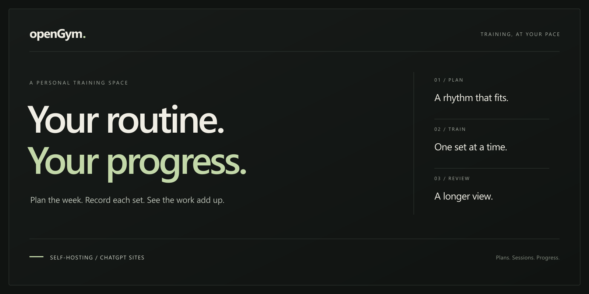

<div align="center">



**从每周计划到最后一组，把训练记录在同一个地方。**

[English](README.md) · [简体中文](README.zh-CN.md)

[功能](#完整的训练流程) · [部署方式](#选择部署方式) · [快速开始](#快速开始) · [文档导航](#目录与文档)

</div>

openGym 将训练计划、引导式训练、历史记录和体重追踪放进一个专注的界面。按星期安排训练，或跟随循环顺序；记录每一组，再回看已经完成的积累。

本仓库是 [DuarteSantos8/openGym](https://github.com/DuarteSantos8/openGym) 的分支。保留上游的自托管应用与原生客户端源码，并新增 **ChatGPT Sites 适配版本**，使用平台登录、按账号隔离的数据、D1 数据库和 R2 媒体存储。

## 完整的训练流程

| 安排计划 | 记录训练 | 查看进步 |
|---|---|---|
| 固定每周安排或重复循环。可编辑的入门模板。器械档案与自定义动作。 | 带上次重量的逐组记录、休息计时与可选 RIR/RPE。支持超级组、热身组、递减组、计时动作和有氧训练。 | 训练历史、个人纪录、估算 1RM、活动热力图与肌肉图。追踪体重、身体围度和进步照片。 |

- **灵活的计划。** 从推／拉／腿、上／下肢、全身或 5×5 模板开始，逐步调整动作、组数、次数和进阶规则。
- **顺手的训练界面。** 在卡片、列表和紧凑视图之间切换。记录单侧训练、计算杠铃配重、重复之前的训练，也能事后修正已保存的记录。
- **可以带走的数据。** 导出 JSON 备份或包含媒体的备份，导入支持的训练历史，并与朋友交换计划文件。计划分享包含训练模板，不包含个人训练历史或体重记录。
- **熟悉的界面选择。** 提供深色、浅色和跟随系统的主题、强调色、可配置的训练控件，以及包括简体中文、繁体中文在内的多种界面语言。

## 选择部署方式

两种网页部署方式共享训练流程，使用不同的账号与存储系统。

| | 自托管网页 / PWA | ChatGPT Sites |
|---|---|---|
| **访问方式** | 自己的服务器；Passkey 与可选密码登录 | 使用 ChatGPT 登录，由 Sites 管理访问权限 |
| **记录存储** | 服务器上的 JSON 文档和上传目录 | 按用户隔离的 D1 文档与 R2 媒体 |
| **数据同步** | 基于版本号的同步与字段级合并 | 将同一套版本与合并机制适配至 D1 |
| **离线使用** | 上游 PWA 提供 Service Worker 缓存 | 已打开的页面会保留本地修改，恢复连接后同步；不支持离线重新打开 |
| **计时提醒** | 页面内提醒；配置后可使用后台 Web Push | 页面保持打开时提供提醒；首次休息计时会解释这一限制 |
| **扩展服务** | 可选 AI 教练、管理后台和原生客户端配对 | 此适配版本禁用这些上游服务 |
| **配置文档** | [自托管指南](docs/SELF_HOSTING.md) | [Sites 配置与开发](sites/opengym/README.md) |

**每个账号有独立的数据边界。** Sites 版本的每位使用者都用自己的 ChatGPT 账号登录，并获得独立的训练档案。即使站点设置为公开访问，打开训练记录仍需登录 ChatGPT。部署管理员可以访问底层存储。

**正在进行的训练留在当前设备。** 计划、已完成的训练、体重和偏好设置随账号同步。尚未完成的训练保存在本地，可以在原设备上继续。

**保留原生客户端源码。** 上游 Capacitor 应用支持把记录保存在手机本地，并连接兼容的自托管服务器。其原生提醒和配对功能与 Sites 部署相互独立。详见[移动端指南](docs/MOBILE.md)与[上游发布页](https://github.com/DuarteSantos8/openGym/releases)。

## 快速开始

### 使用 Docker 自托管

安装 Docker 和 Compose 后，在仓库根目录运行：

```powershell
Copy-Item .env.example .env
docker compose pull
docker compose up -d
```

打开 [localhost:8080](http://localhost:8080)。Compose 配置拉取的是 **上游 openGym 镜像**。手机通过 Passkey 访问需要 HTTPS 部署；[自托管指南](docs/SELF_HOSTING.md)介绍了域名、反向代理、账号与备份的配置。

如需从本仓库源码构建自托管应用：

```sh
docker compose up -d --build
```

### 使用 ChatGPT Sites 部署

请按照独立的 [Sites 指南](sites/opengym/README.md)准备 Node.js、动作媒体、D1 迁移、本地开发与部署配置。Sites 应用位于 `sites/opengym/`，使用平台提供的登录和访问控制。

托管版本在“关于”页面提供对应源码下载。动作媒体采用单独的许可条款，不包含在源码 ZIP 中。

## 目录与文档

```text
openGym/
├── frontend/             上游 React/Vite 应用与 Android/iOS 源码
├── api/                  上游 Node API、账号与 JSON 存储
├── web/                  Docker 网页镜像与 nginx 配置
├── catalogue/            动作数据、翻译与单独授权的媒体
├── sites/opengym/        ChatGPT Sites 应用及部署工具
│   ├── gym-client/       适配后的训练界面
│   ├── lib/              托管 API、同步与页面响应
│   ├── db/ + drizzle/    D1 表结构及迁移
│   └── tests/            托管 API 测试
└── docs/                 自托管、移动端、数据导入及上游指南
```

| 继续阅读 | |
|---|---|
| [Sites 适配](sites/opengym/README.md) | 功能、配置、存储和托管版本限制 |
| [自托管](docs/SELF_HOSTING.md) | 部署与维护原版服务器 |
| [移动端](docs/MOBILE.md) | 上游 Android、iOS 与 PWA 说明 |
| [数据导入](docs/DATA_IMPORTS.md) | 支持的数据来源与格式 |
| [原项目 README](docs/UPSTREAM_README.md) | 归档保留的上游介绍 |
| [参与贡献](CONTRIBUTING.md) | 上游贡献流程与项目约定 |

## 署名与许可

openGym 由 Duarte Santos 创建。本分支保留上游应用的作者署名和许可证；Sites 集成是在该应用基础上的适配。

应用源码使用 **[AGPL-3.0-or-later](LICENSE)**。动作图片与动画采用单独的许可条款：非商业 openGym 分支可保留未经修改的 180 px 素材及其声明。完整的动作媒体条款和其他第三方署名见 **[NOTICE.md](NOTICE.md)**。
